<!-- ═══════════════ HERO ═══════════════ -->
<p align="center">
  <a href="https://portafoliosergy.netlify.app/">
    
  </a>
</p>

<p align="center">
  <a href="https://portafoliosergy.netlify.app/">
    
  </a>
</p>

<p align="center">
  <a href="https://portafoliosergy.netlify.app/"></a>
  <a href="https://www.linkedin.com/in/sergio-velasco-daza/"></a>
  <a href="mailto:velascodazasergio@gmail.com"></a>
  <a href="https://github.com/velascodazasergio-png?tab=repositories"></a>
</p>

<p align="center">
  
  
  
</p>

<br/>

<!-- ═══════════════ 01 · SOBRE MÍ ═══════════════ -->


<table>
<tr>
<td width="55%" valign="top">

Desarrollador de software en formación en **Campuslands** 🇨🇴. Me gusta convertir problemas reales en soluciones de software claras, mantenibles y bien estructuradas.

- 🔭 **Construyendo:** mi portafolio web, dinámico y con animaciones.
- 🚚 **En equipo:** *RapidExpress*, gestión de flotas y rutas en Java + MySQL.
- 🕵️ **Practicando:** SQL resolviendo casos tipo *murder mystery*.
- 🌱 **Aprendiendo:** Spring Boot, APIs REST y testing con JUnit.
- 📐 **Filosofía:** código limpio, capas bien separadas y bases de datos bien diseñadas.

</td>
<td width="45%" valign="top">

```java
public class SergioVelasco {

    String ubicacion = "Colombia 🇨🇴";
    String formacion = "Campuslands";

    String[] backend  = {"Java", "Maven"};
    String[] datos    = {"MySQL", "SQLite"};
    String[] frontend = {"HTML", "CSS", "JS"};

    String arquitectura = "MVC";

    boolean abiertoAColaborar() {
        return true;
    }
}
```

</td>
</tr>
</table>

<br/>

<!-- ═══════════════ 02 · LO QUE HAGO ═══════════════ -->


<p align="center">
  
</p>

<div align="center">

| ⚙️ Backend | 🗄️ Bases de datos | 🎨 Frontend | 🧰 Herramientas |
| :---: | :---: | :---: | :---: |
|  |  |  |  |

</div>

<br/>

<!-- ═══════════════ 03 · PROYECTOS ═══════════════ -->


<p align="center">
  <a href="https://github.com/velascodazasergio-png/RapidExpress-triada"></a>
  <a href="https://portafoliosergy.netlify.app/"></a>
</p>
<p align="center">
  <a href="https://github.com/velascodazasergio-png?tab=repositories"></a>
  <a href="https://github.com/velascodazasergio-png?tab=repositories"></a>
</p>

<br/>

<!-- ═══════════════ 04 · ESTADÍSTICAS ═══════════════ -->
<!-- Tarjetas propias generadas por scripts/cards.py (workflow readme-cards.yml) -->


<p align="center">
  
  
</p>

<p align="center">
  
</p>

<p align="center">
  
</p>

<br/>

<!-- ═══════════════ 05 · CONTACTO ═══════════════ -->


<div align="center">

### 💗 ¡Construyamos algo increíble juntos!

¿Tienes una idea, un proyecto o una oportunidad? Me encantará escucharte.

<a href="mailto:velascodazasergio@gmail.com"></a>
<a href="https://www.linkedin.com/in/sergio-velasco-daza/"></a>
<a href="https://portafoliosergy.netlify.app/"></a>

<br/><br/>

<a href="https://github.com/velascodazasergio-png"></a>

<sub><b>© 2026 Sergio Velasco Daza</b> · Construido con pasión por el código y el detalle</sub>

</div>


