<!-- ═══════════════ HERO ═══════════════ -->

  <a href="https://portafoliosergy.netlify.app/">
    
  </a>

  

  
  
  
  

  
  
  
  

 

<!-- ═══════════════ 01 · SOBRE MÍ ═══════════════ -->

<table>
<tr>
<td width="55%" valign="top">

Soy **desarrollador de software en formación en Campuslands**. Tengo experiencia práctica en **desarrollo de sistemas, bases de datos, automatización, inteligencia artificial y desarrollo web**, y participo en proyectos completos: desde el diseño de la solución y el desarrollo de funcionalidades hasta la integración de bases de datos, automatizaciones y herramientas modernas.

- ⚛️ **Construyo:** interfaces modernas con React y TypeScript, y backends con Java y Spring Boot.
- 🤝 **En equipo:** Campus Ops, CampusDesk, NutriGuide y RapidExpress, trabajando con Git por ramas.
- 🤖 **Me apasiona:** automatizar flujos con **n8n** e integrar IA con **OpenAI** y **Google Gemini** (RAG).
- 🗄️ **Fuerte en datos:** MySQL y PostgreSQL con triggers, procedimientos y roles.
- 🌐 **Idiomas:** Español (nativo) · Inglés (B1).

> **Mi diferencial:** combino aprendizaje constante, pensamiento analítico y adaptación tecnológica con la creación de soluciones prácticas.

</td>
<td width="45%" valign="top">


</td>
</tr>
</table>

<table>
<tr>
<td width="50%" valign="top">

#### 🎯 Mi misión
Desarrollar soluciones de software que conviertan problemas reales en herramientas **útiles, eficientes e innovadoras**, mientras sigo aprendiendo y creciendo como profesional de la tecnología.

</td>
<td width="50%" valign="top">

#### 🔭 Mi visión
Consolidarme como un desarrollador capaz de participar en **proyectos tecnológicos de alto impacto**, aportar soluciones innovadoras y seguir evolucionando junto con las nuevas tecnologías.

</td>
</tr>
</table>

  
  
  
  
  

 

<!-- ═══════════════ 02 · LO QUE HAGO ═══════════════ -->

  

  

| | |
| :--- | :--- |
| **💻 Lenguajes** |  |
| **⚛️ Frameworks** |  |
| **🗄️ Bases de datos** |  |
| **🧰 Herramientas** |  |
| **🤖 IA y automatización** |     |
| **🛠️ También uso** |    |

 

<!-- ═══════════════ 03 · PROYECTOS ═══════════════ -->

  <a href="https://github.com/velascodazasergio-png/CampusVerse-AI-hackathon"></a>
  <a href="https://github.com/velascodazasergio-png/hackathon2.01"></a>

  <a href="https://github.com/Mafeqm/Nutriguide"></a>
  <a href="https://github.com/velascodazasergio-png/HelpDeskAI"></a>

  <a href="https://github.com/Mic022/CampusDesk_Springboot_Proyect"></a>
  <a href="https://github.com/velascodazasergio-png/RapidExpress-triada_JAVA"></a>

  <a href="https://github.com/velascodazasergio-png/CoworkingSpace-DB"></a>
  <a href="https://github.com/velascodazasergio-png/Proyecto_JavaScript_velascosergy"></a>

  <a href="https://billie-eilish-web.vercel.app"></a>
  <a href="https://github.com/velascodazasergio-png/proyect-kuromi"></a>

  <a href="https://github.com/velascodazasergio-png/music-stream-app"></a>
  <a href="https://github.com/velascodazasergio-png?tab=repositories"></a>

  

 

<!-- ═══════════════ 04 · LOGROS Y FORMACIÓN ═══════════════ -->

  

 

<!-- ═══════════════ 05 · ESTADÍSTICAS ═══════════════ -->
<!-- Tarjetas propias generadas por scripts/cards.py (workflow readme-cards.yml) -->

  
  

  

  

 

<!-- ═══════════════ 06 · CONTACTO ═══════════════ -->

  

### 💗 ¿Creamos algo juntos?

Estoy buscando **oportunidades en desarrollo de software**. 
Si tienes un proyecto, una vacante o una idea, escríbeme.

  

<a href="https://github.com/velascodazasergio-png">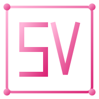</a>

<b>© 2026 Sergio Velasco Daza</b> · Construido con pasión por el código y el detalle

